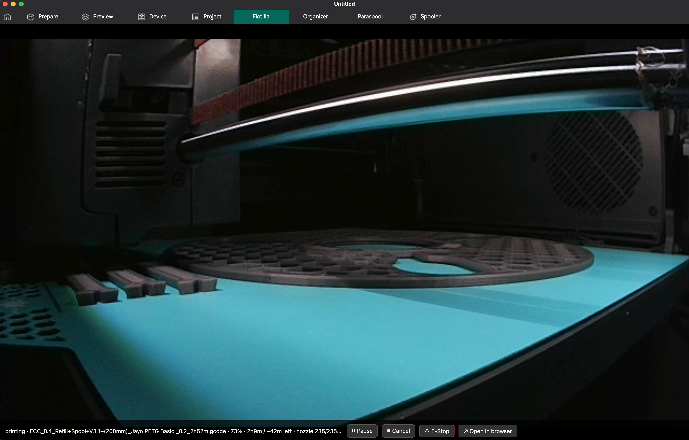

# Flotilla

OrcaSlicer plugin that adds a **Flotilla** tab: a live camera grid for every printer OrcaSlicer knows about, with a fullscreen view that shows print status and offers Pause/Resume, Cancel, and E-Stop. Orca's Device tab only shows the selected printer; this shows all of them.

Requires OrcaSlicer 2.5+ (plugin pages). No dependencies; one file, standard library only.





## Install

Download `src/flotilla.py`, then in OrcaSlicer: Plugins → **Install local plugin** → pick the file. Or copy it to `<Orca data dir>/orca_plugins/flotilla/flotilla.py` and restart Orca.

## Features

- One tile per printer preset that has a `print_host` (deduped by host). Search box and tile-size slider.
- Click a tile to fill the tab. The HUD shows state, file, progress, time, and temperatures, with Pause/Resume, Cancel, E-Stop (each behind a confirm), and Open in browser.
- Supported control protocols, auto-detected per host: **Moonraker** (Klipper: Sovol, Qidi, Mainsail/Fluidd setups) and **Elegoo SDCP** (Centauri Carbon). Others get camera only.
- Camera URL is guessed from `host_type` (`/webcam/?action=stream` for Moonraker and OctoPrint, `:3031/video` for Elegoo, `/webcam/snapshot` for PrusaLink) and can be overridden per printer in the plugin's config page. Bambu printers have no HTTP stream; point a [go2rtc](https://github.com/AlexxIT/go2rtc) relay at them and paste its MJPEG URL.
- Dead tiles retry on the **Auto-retry** interval in the tab bar (default on, 1 minute).

## Troubleshooting

Flotilla writes one JSON-lines log, `flotilla.log`, in its plugin storage folder (`<Orca data dir>/orca_plugins/plugin_data/<plugin id>/`). The **Log** button in the tab bar opens it. Each entry carries the printer name, host, detected protocol, firmware, the command, timing, and the error if any. It rotates to `flotilla.log.1` at 2 MB. Attach both files to a bug report.

## Development

```
python3 -m unittest discover -s tests -v
```

The plugin is deliberately a single file so Orca can install it directly. Keep it that way.

## License

[MIT](LICENSE.md)

## Releasing

Bump `version` in the header of `src/flotilla.py`, commit, then tag and push. CI runs the tests, checks the tag matches the header, and publishes a GitHub Release with `flotilla.py` attached.

```
git tag v0.2.0 && git push --tags
```
