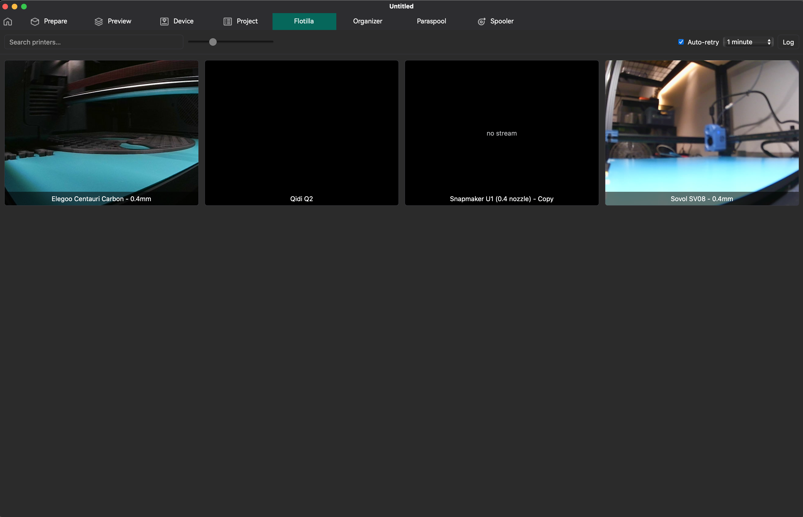

# Flotilla

OrcaSlicer plugin that adds a **Flotilla** tab: a live camera grid for every printer OrcaSlicer knows about, with a fullscreen view that shows print status and offers Pause/Resume, Cancel, and E-Stop. Orca's Device tab only shows the selected printer; this shows all of them.

Requires OrcaSlicer 2.5+ (plugin pages). No dependencies; one file, standard library only.




## Install

Download `src/flotilla.py`, then in OrcaSlicer: Plugins → **Install local plugin** → pick the file. Or copy it to `<Orca data dir>/orca_plugins/flotilla/flotilla.py` and restart Orca.

## Features

- One tile per printer preset that has a `print_host` (deduped by host). Search box and tile-size slider.
- Click a tile to fill the tab. The HUD shows state, file, progress, time, and temperatures, with Pause/Resume, Cancel, E-Stop (each behind a confirm), and Open in browser.
- Supported control protocols, auto-detected per host: **Moonraker** (Klipper: Sovol, Qidi, Mainsail/Fluidd setups) and **Elegoo SDCP** (Centauri Carbon). Others get camera only.
- Camera URL is guessed from `host_type` (`/webcam/?action=stream` for Moonraker and OctoPrint, `:3031/video` for Elegoo, `/webcam/snapshot` for PrusaLink) and can be overridden per printer in the plugin's config page. Bambu printers have no HTTP stream; point a [go2rtc](https://github.com/AlexxIT/go2rtc) relay at them and paste its MJPEG URL.
- Dead tiles retry on the **Auto-retry** interval in the tab bar (default on, 1 minute). Keep it at 1 minute or more for Elegoo printers: the Centauri Carbon camera allows only a few viewers and answers `too many client` when saturated, so hammering it every second does not help.
- Live tiles re-request their stream every 15 minutes, and clicking a tile reloads it. Both close the old connection before opening the new one.

## Help wanted: try it with your printers

Flotilla has been tested on exactly two printers: a Sovol SV08 (stock Klipper + Moonraker) and an Elegoo Centauri Carbon (Elegoo's SDCP protocol). Everything else is a guess, so the most useful thing you can do is try it and report back, whether it works or not.

What we expect, by printer type:

| Type | Examples | Camera | Status and controls |
|---|---|---|---|
| Klipper with Moonraker | Voron, Sovol, Qidi, Creality with Mainsail/Fluidd | Should work | Should work |
| Klipper-derived with vendor firmware | Elegoo Centauri Carbon, Creality K1/K2, Qidi stock, Snapmaker, Anycubic Kobra | Depends on the vendor | Elegoo works; others unknown |
| Not Klipper | Bambu Lab, Prusa (PrusaLink), OctoPrint, Flashforge | Bambu: no, their stream is proprietary. Others: unknown | Not implemented |

Bambu Lab is the big open question. Orca has its own Bambu network module and there is an open reimplementation of it; whether either can feed a plugin like this is unknown, and so is whether it should be expected to. If you have Bambu printers and ideas, open an issue.

### How to report

1. Open the Flotilla tab, click the **Log** button, and grab `flotilla.log` (and `flotilla.log.1` if it exists). It lives in `<Orca data dir>/orca_plugins/plugin_data/<plugin id>/`. On macOS the data dir is `~/Library/Application Support/OrcaSlicer`, on Windows `%APPDATA%\OrcaSlicer`, on Linux `~/.config/OrcaSlicer`.
2. File an issue at https://github.com/bmelton/flotilla/issues with: printer model and firmware version, how Orca connects to it (the preset's host type and whether you use a physical printer), what you saw, and the log attached. Working reports are as welcome as broken ones; they go in the table above.

The log is JSON lines. Each entry names the printer, host, detected protocol, firmware, the command, timing, and any error. It contains your printer hostnames or IPs and nothing else sensitive, but skim it before posting if that matters to you.

## Troubleshooting

Flotilla writes one JSON-lines log, `flotilla.log`, in its plugin storage folder (`<Orca data dir>/orca_plugins/plugin_data/<plugin id>/`). The **Log** button in the tab bar opens it. Each entry carries the printer name, host, detected protocol, firmware, the command, timing, and the error if any. It rotates to `flotilla.log.1` at 2 MB. Attach both files to a bug report.

## Development

```
python3 -m unittest discover -s tests -v
```

The plugin is deliberately a single file so Orca can install it directly. Keep it that way.

## License

[MIT](LICENSE.md)

## Releasing

Bump `version` in the header of `src/flotilla.py`, commit, then tag and push. CI runs the tests, checks the tag matches the header, and publishes a GitHub Release with `flotilla.py` attached.

```
git tag v0.2.0 && git push --tags
```
